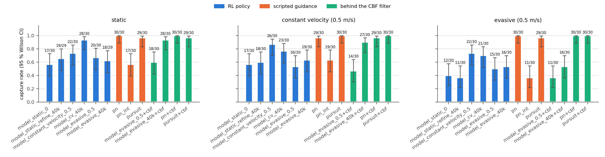
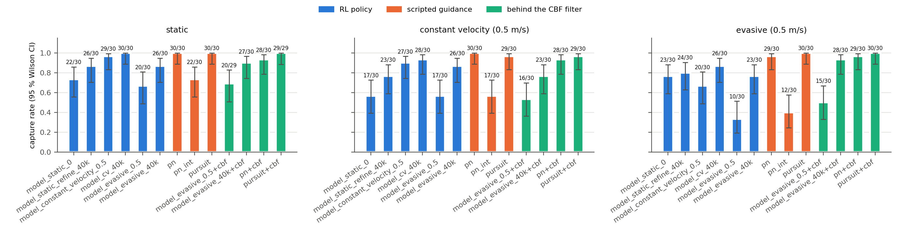

# Interception RL results

Drone-to-drone interception trained on the AeroGym-PX4 sim (PX4 SITL in the
loop, two vehicles per worker, sim-time stepping at 4x). SAC, velocity action
interface, managed two-vehicle stacks.

## Pipeline validation

The full RL loop works end-to-end: the `InterceptSimInstance` boots an
interceptor + a scripted target in one gz world, `InterceptEnv` exposes the
relative-state observation, and SB3 trains a capture policy with the AeroGym
reliability machinery (zero wedges across all runs).

Pre-training sanity: a hand-coded P-controller chase captured a static target
in **6.3 s** sim — confirming the action/observation/reward wiring.

## Eval-reset robustness fix

The single-env evaluator used to produce spurious 0.06–0.17 s episodes after the
first terminal episode: a crash/out-of-bounds left the craft grounded (arming
lockout) or escaped (airborne, far from spawn), and the old reset only checked
"airborne", so it started the next episode wherever the craft was → instant
re-termination, cascading. Fixed in `aerogym_px4` `BasePX4Env._ensure_ready`:
every reset now verifies the craft is **finite + in-bounds + near spawn + armed**
and escalates per-episode — airborne→teleport-home, grounded→level-and-takeoff,
and a **stack restart** fallback for the escaped/EKF-diverged case. Result: every
eval episode is a full-length attempt again (6/6 clean, consistent min-ranges).

## Reward rework

The first reward (closing + range + alignment + a narrow precision bell) trained
a policy that looked fine in stochastic training (ep_len 400, no crashes) but
**sank into the ground when evaluated deterministically** — SAC's exploration
noise had been holding it aloft. Reworked in `aerogym_intercept/task.py`:

* **dense altitude-floor penalty** above the crash line — a continuous upward
  gradient so the deterministic policy never learns to sink (the one-shot −1000
  crash was too sparse for the value function under exploration);
* **dense arena-boundary penalty** near the walls/ceiling — same idea, stops the
  policy overshooting the target straight out of bounds;
* **wide, strong near-field bell** (`prec_sigma` 4.0, `w_prec` 6.0) + a small
  constant inward `w_range` pull — a narrow bell parked the policy at ~3.8 m
  (outside the bell, where its gradient is flat); the wide bell pulls the
  equilibrium all the way into the capture gate.

Each change was driven by an observed eval failure (sink → floor; overshoot-oob
→ boundary; park-at-3.8 m → wide bell), mirroring how the AeroGym hover task was
shaped over several iterations.

## Stage 1 — static target (SAC), reward-shaping trajectory

All evals are 6 deterministic episodes, capture gate 1.0 m.

| policy / budget | capture | mean min-range | behaviour |
|---|---|---|---|
| v1 (old reward, 450k) | 2/6 | — | deterministic **sink & crash** |
| v3 80k (floor + boundary) | 0/6 | 3.78 m | stable, in-bounds, parks too far |
| v4 60k (wide strong bell) | 1/6 | 57 m | captures but **overshoots/oob** (under-trained, aggressive) |
| v4 100k | 2/6 | 1.17 m | stable, tight, all 6 within 1.5 m |
| v4 120k | 2/6 | 1.05 m | stable, all 6 within 1.36 m, 0 crash / 0 oob |
| **refine 40k (best)** | **9/10** | **0.96 m** | bootstrap + tight bell + LR 1e-4; 0 crash / 0 oob |

v4 reliably closed to the **1.0 m capture boundary** but parked just outside it
(2/6, equilibrium ~1.05 m). The **refine** run fixed that: bootstrap the v4-120k
weights, swap in a tighter/stronger near-field bell (`config/refine_tight.yaml`:
`prec_sigma` 3.0, `w_prec` 8.0) to pull the equilibrium *under* the gate, at a
lower LR (1e-4) for stability. Result: **9/10 capture, mean closest approach
0.96 m, 0 crashes / 0 out-of-bounds** (verified on a held-out seed, 10 eps). The
deliverable is **`model_static_refine_40k.zip`**.

### SAC stability note (use early stopping)

Both runs peak then drift, so checkpoint and pick the best:
* the from-scratch v4 run **diverged** past its ~120 k peak (ep_rew +682 → −1790
  by 140 k — Q-overestimation from the +1000 capture target + auto-entropy);
* the refine run was stable (LR 1e-4 + fixed entropy, no collapse) but
  **over-trained into aggression** past ~40 k — the 60 k checkpoint dashes and
  flies out of bounds deterministically (1/6) despite a high *stochastic* reward
  (+620). Classic stochastic-vs-deterministic divergence: always confirm with a
  deterministic eval, not the training curve.

The tighter bell lives in a config override, **not** the task defaults: a narrow
bell only works as a warm-start refine (the craft already near the target); a
fresh run with it parks far out (the v3 failure).

## Curriculum (completed)

Target-policy axis, each stage bootstrapped from the previous stage's best
checkpoint (policy-weights transfer, fixed low entropy, LR 1e-4, tight-bell
config). Evals are 10 deterministic episodes on a held-out seed (200).

| stage | model | capture | mean min-range | mean t_capture |
|---|---|---|---|---|
| static | `model_static_refine_40k.zip` | **9/10** | 0.96 m | — |
| constant_velocity (0.5 m/s) | `model_cv_40k.zip` | **10/10** | 0.78 m | 7.4 s |
| evasive (0.5 m/s) | `model_evasive_40k.zip` | **9/10** | 0.97 m | 18.8 s |

Capture time rises with difficulty (cornering a dodging target takes longer),
as expected. Each stage peaks ~40 k then risks the over-train/collapse drift, so
the 40 k checkpoint is kept for each. Reproduce:

```bash
ros2 run d2dtracker_rl train_intercept --target-policy constant_velocity \
    --init-from checkpoints/intercept/model_static_refine_40k.zip \
    --env-config config/refine_tight.yaml --learning-rate 1e-4 --ent-coef 0.1 \
    --timesteps 100000 --speed-factor 4 --pair-rank 0
# ...then --target-policy evasive --init-from .../model_cv_40k.zip
ros2 run d2dtracker_rl evaluate_intercept --model checkpoints/intercept/model_evasive_40k.zip \
    --target-policy evasive --target-speed 0.5 --episodes 10 --rank 2
```

### Two-vehicle reset fix (what unblocked the curriculum)

The first curriculum attempt produced a flaky `constant_velocity` (4/10) that
then collapsed in training. Root cause was **not** the policy: capturing the
target makes the two physical gz models collide, knocking the **target** to the
ground, and the old airborne-only target teleport could not recover it — leaving
the next episode with a grounded, mis-placed target (seen at `[-22.9,-5.4,0.2]`)
that was unwinnable and poisoned the replay buffer. Fixed in
`InterceptEnv._cosettle`: after the interceptor reset, stream **both** vehicles'
setpoints together until each is at its start and airborne (both PX4s need
continuous OFFBOARD), recovering a knocked-down target. With the fix,
`constant_velocity` went 4/10 → **10/10**. (A diagnostic that prints both
vehicles' start/end positions per episode is the fastest way to catch this class
of two-vehicle reset bug — a physically impossible min-range, e.g. 237 m for a
0.5 m/s target, points straight at a corrupted vehicle state.)

## Caveat found 30 Oct 2026: the control period depends on machine load

`BasePX4Env._wait_tick` waits until sim time reaches *(sim time when the action
was sent) + control_dt*. The sim keeps running while the agent computes, at up
to the speed cap, so every millisecond of wall time between steps adds
`speed_factor` milliseconds of sim time to the step. The effective control
period is therefore `control_dt + speed_factor x (per-step wall overhead)`, not
0.05 s:

| run | measured | effective period |
|---|---|---|
| June evaluations above (`eval_refine_40k_verify.log`) | 400-step timeout at 54.98 s sim | ~0.137 s/step |
| 30 Oct re-evaluation, 4x, load ~50 on 32 cores | 400 steps in 32–34 s sim | ~0.08 s/step |
| June training (SAC update every step), from SB3 `fps` 11–15 | ~77 ms wall per step at up to 4x | up to ~0.3 s/step (estimate; not logged) |

The policies were trained and evaluated at different, load-dependent control
rates, so the capture rates above hold for the conditions they were measured
in and are not directly comparable with a re-run on a machine under a
different load. The 30 Oct re-evaluation of the static model gave 7/30 (vs 9/10
in June) at 0.08 s/step. `evaluate_intercept` now logs `step_dt_s` per episode
for this reason. The fix is deterministic stepping (pause the world, advance a
fixed number of physics iterations per action), which makes the period exact
and load-independent: AeroGym `step_mode: lockstep` (ROADMAP C8), used for the
evaluation below.

## Evaluation matrix in lockstep (31 Oct 2026)

The three June stage models against the scripted guidance laws, with and
without the CBF safety filter (ROADMAP C3, D2). Every step is exactly 0.05 s
(`--step-mode lockstep`). 30 deterministic episodes per cell on the test seed
200, the same episodes for every policy; moving targets at 0.5 m/s.
`scripts/eval_matrix.sh` on stack 2 (PX4 instances 2–3, domain 31). 810
episodes; 2 are excluded because the target was not at its start. Data, table
and figure: [`docs/eval/2026-10-31_lockstep/`](docs/eval/2026-10-31_lockstep/).
Trajectories (8.6 MB) and per-cell logs stay on the lab desktop in
`~/drone_interception_ws/rl_eval/2026-10-31_lockstep/`.



| policy | static | constant velocity | evasive |
|---|---|---|---|
| `model_static_refine_40k` | 19/29 | 18/30 | 11/30 |
| `model_cv_40k` | **28/30** | **23/30** | **21/30** |
| `model_evasive_40k` | 18/29 | 19/30 | 16/30 |
| `pn` (N = 3) | 30/30 | 29/30 | 30/30 |
| `pn_int` (constant 6 m/s) | 17/30 | 19/30 | 11/30 |
| `pursuit` | 29/30 | 30/30 | 29/30 |
| `model_evasive_40k` + CBF | 28/30 | 27/30 | 16/30 |
| `pn` + CBF | 30/30 | 29/30 | 30/30 |
| `pursuit` + CBF | 29/30 | 30/30 | 30/30 |

Wilson intervals, capture times, closest approach, crashes and lowest altitude
are in [`summary.md`](docs/eval/2026-10-31_lockstep/summary.md).

- **The June models capture far less than they did in June:** 11–28 of 30, against
  9/10–10/10 then. Retraining at the evaluation period (below) does not change
  that; the shorter episode does most of it (20 s here, about 55 s in June; see
  "Episode length is what changed").
- **The constant-velocity model is the best RL policy on every target**
  (28, 23, 21 of 30). The evasive refine that followed it is worse on all three
  (18, 19, 16), so that stage did not help.
- **RL failures are near misses and crashes.** The RL non-captures come within
  a median 1.4–1.8 m of the target. `model_evasive_40k` crashed or left the
  arena in 4–8 episodes per target, with its lowest altitude below 0 m.
- **The CBF filter removes most of those crashes:** `model_evasive_40k` goes
  from 18 to 28 captures on the static target and from 19 to 27 at constant
  velocity (crash or out-of-bounds 6 → 1 and 8 → 1). Against the evasive target
  it does not help (16 → 16), because the failures there are timeouts. The
  filter changed the command in 4–10 % of steps. It costs the baselines
  nothing in captures; PN takes longer on the static target (median 4.6 → 6.3 s).
- **PN and pursuit capture 29–30 of 30 at 0.5 m/s.** The evaluator uses the
  same `d2dtracker_interception.guidance` functions as the guidance node. In
  the benchmark scene, with a 2.4 m/s circling target, the same PN law captures
  4 of 19 (`drone_interception_sim/BENCHMARKS.md`), so its failure there depends
  on target speed and geometry.
- **Constant-speed PN (`pn_int`) overshoots:** it captures fast when it
  captures (median 2.5 s) but leaves the arena in 10–17 episodes per target.

### Retrained in lockstep (ROADMAP C9)

The same curriculum and recipe, retrained with the exact 0.05 s period:
`scripts/curriculum.sh checkpoints/lockstep "static:0 constant_velocity:0.5
evasive:0.5" 40000`, from the June static model, each stage's checkpoint
chosen on 10 episodes of seed 100. The kept 40 k checkpoints scored 8/10,
10/10 and 7/10 there. On the test episodes (same matrix, same seed 200):

| model (stage) | static | constant velocity | evasive |
|---|---|---|---|
| `model_static_0` (lockstep) | 17/30 | 17/30 | 12/30 |
| `model_static_refine_40k` (June) | 19/29 | 18/30 | 11/30 |
| `model_constant_velocity_0.5` (lockstep) | 22/30 | **26/30** | **22/30** |
| `model_cv_40k` (June) | **28/30** | 23/30 | 21/30 |
| `model_evasive_0.5` (lockstep) | 20/30 | 16/30 | 15/30 |
| `model_evasive_40k` (June) | 18/29 | 19/30 | 16/30 |
| `model_evasive_0.5` + CBF | 18/30 | 14/30 | 11/30 |
| `model_evasive_40k` + CBF | 28/30 | 27/30 | 16/30 |

- **Retraining at the evaluation period does not recover June's numbers.**
  Each retrained model is within a few episodes of its June counterpart, and
  the intervals overlap everywhere. So the mismatch in control period is not
  what keeps the models well below June's 9–10 of 10.
- **The constant-velocity stage is again the best,** and the evasive stage
  again makes it worse on every target.
- **10 selection episodes overestimate:** 10/10 and 7/10 on seed 100 became
  26/30 and 15/30 on the test seed.
- **The CBF filter does not rescue the retrained evasive model:** its crashes
  become timeouts (16 and 18 of 30 against the moving targets), not captures.
  For the June model it turned crashes into captures. So what the filter is
  worth depends on the policy behind it; it is not a fixed gain.

### Episode length is what changed

An episode ends after 400 steps. At the exact 0.05 s period that is 20 s of
sim time; in June, at about 0.137 s per step, it was about 55 s. Three cells
re-run with `--episode-steps 1100` (55 s), seed 200, 30 episodes (data:
[`docs/eval/2026-10-31_long_episodes/`](docs/eval/2026-10-31_long_episodes/)):

| model vs target | captures, 20 s | captures, 55 s | of which after 20 s | timeouts 20 s → 55 s | crash or out of bounds 20 s → 55 s |
|---|---|---|---|---|---|
| June static model vs static | 19/29 | **27/30** | 6 | 10 → 1 | 0 → 2 |
| June evasive model vs evasive | 16/30 | 20/30 | 4 | 10 → 1 | 4 → 9 |
| lockstep static model vs evasive | 12/30 | 14/30 | 6 | 15 → 1 | 3 → 15 |

- **Almost every timeout ends before 55 s:** against the static target as a
  capture, against the evasive target often as a crash. The 20 s limit hides
  those crashes.
- **At June's episode length the June static model captures 27/30,** in line
  with its June 9/10. So the drop in the matrix above comes mostly from the
  shorter episode, not from the policies.
- **The slow captures are slow:** 4–6 per cell needed more than 20 s (up to
  51 s).
- **Outcomes do not repeat episode by episode.** Lockstep fixes the control
  period, but PX4 and Gazebo still run their own threads, and a longer episode
  also changes the state the next reset starts from. Of the 16 episodes the
  June evasive model captured in the 20 s run, 6 ended otherwise in the 55 s
  run, where a deterministic repeat would have captured them at the same
  time. Compare
  rates between runs, not single episodes.

### The whole matrix at 55 s (ROADMAP C10)

All 13 policies again with `EPISODE_STEPS=1100` (55 s), seed 200, 30
episodes per cell, on stack 2. 1170 episodes; 2 are excluded because the
target was not at its start. The bracketed numbers are the captures made
within 20 s in the same run (`analyze_eval.py --budget 20`). Data, table and
figure: [`docs/eval/2026-10-31_lockstep_55s/`](docs/eval/2026-10-31_lockstep_55s/);
trajectories (18 MB) stay in `~/drone_interception_ws/rl_eval/2026-10-31_lockstep_55s/`.



| policy | static | constant velocity | evasive |
|---|---|---|---|
| `model_static_0` (lockstep) | 22 (20) | 17 (17) | 23 (18) |
| `model_static_refine_40k` (June) | 26 (21) | 23 (16) | 24 (15) |
| `model_constant_velocity_0.5` (lockstep) | 29 (29) | 27 (26) | 20 (13) |
| `model_cv_40k` (June) | **30 (30)** | **28 (28)** | **26 (25)** |
| `model_evasive_0.5` (lockstep) | 20 (14) | 17 (12) | 10 (6) |
| `model_evasive_40k` (June) | 26 (25) | 26 (25) | 23 (21) |
| `pn` | 30 (30) | 30 (30) | 29 (29) |
| `pn_int` | 22 (22) | 17 (17) | 12 (12) |
| `pursuit` | 30 (30) | 29 (29) | 30 (30) |
| `model_evasive_0.5` + CBF | 20 of 29 (17) | 16 (15) | 15 (9) |
| `model_evasive_40k` + CBF | 27 (25) | 23 (22) | 28 (22) |
| `pn` + CBF | 28 (28) | 28 (28) | 29 (29) |
| `pursuit` + CBF | 29 of 29 (29) | 29 (29) | 30 (30) |

- **Given 55 s, the best RL policy nearly matches the scripted laws.**
  `model_cv_40k` captures 30, 28 and 26 of 30, against 30, 30, 29 for PN and
  30, 29, 30 for pursuit. Its median capture time (3.6–4.0 s) lies between
  pursuit's (2.0–4.2 s) and PN's (5.1–6.0 s).
- **Only the RL policies gain from the longer episode.** Within this run the
  June models go from 206 to 232 of 270 captures between 20 s and 55 s, the
  lockstep models from 155 to 185, the RL policies behind the CBF from 110 to
  129. The scripted laws make all 402 of their captures within 20 s.
- **At 55 s the June models beat the lockstep retrain,** 232 against 185 of
  270. The gap is widest at the evasive stage: `model_evasive_0.5` captures 10
  of 30 evasive targets and leaves the arena in 12, where `model_evasive_40k`
  captures 23. The June models trained on episodes of about 55 s, the retrain
  on 20 s ones. ROADMAP C11 retrains the curriculum with 55 s episodes to test
  whether that is the cause.
- **Behind the CBF the June evasive model captures 28 of 30 evasive targets**
  (23 without; crash or out of bounds 6 → 1). Against the constant-velocity
  target it does worse with the filter (26 → 23), within the run-to-run
  spread below.
- **A cell's result varies more between runs than sampling explains.** The
  bracketed 20 s counts repeat the 20 s matrix above: same seed, same budget.
  The scripted cells agree within 1.2 captures on average (at most 5). The RL
  cells differ by 4–5 on average and by up to 9 (lockstep
  `model_constant_velocity_0.5` against the evasive target: 22, then 13), where
  binomial sampling alone gives about 3. Summed over the June models the two
  runs give 173 and 206 of 270. So a difference of a few captures between two
  RL cells of one run is not a finding; the paper should pool runs or use more
  episodes per cell.

## Environment note

MAVROS must be rebuilt after a system `diagnostic_updater` update (ABI change) or
every boot fails with `boot failed: ['mavros']` (undefined-symbol, exit 127):
`colcon build --packages-select mavros mavros_extras`.

## Reproduce

```bash
# 1. base run (keep the best ~100-120k checkpoint; later checkpoints collapse)
ros2 run d2dtracker_rl train_intercept --timesteps 150000 --speed-factor 4 --pair-rank 0
# 2. refine: bootstrap the best base model with a tighter bell at a low LR
#    (keep the best ~40k checkpoint; later checkpoints over-train into aggression)
ros2 run d2dtracker_rl train_intercept --target-policy static \
    --init-from checkpoints/intercept/model_static_v4_best.zip \
    --env-config config/refine_tight.yaml --learning-rate 1e-4 \
    --ent-coef 0.1 --timesteps 100000 --speed-factor 4 --pair-rank 0
# 3. evaluate deterministically on a disjoint stack (the real signal)
ros2 run d2dtracker_rl evaluate_intercept \
    --model checkpoints/intercept/model_static_refine_40k.zip \
    --episodes 10 --target-policy static --rank 2
```
